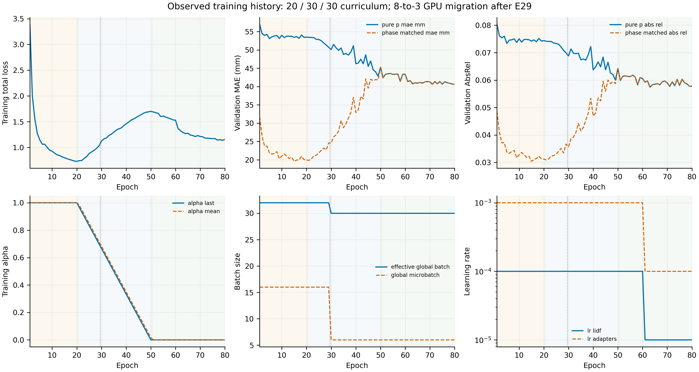
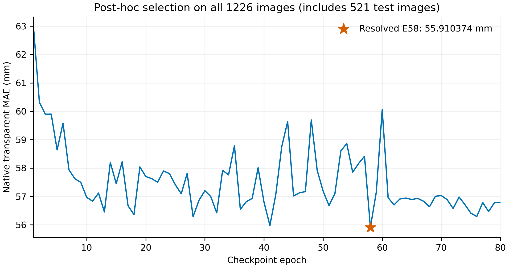

# RGB-only 两阶段深度估计：完整实验与发布验证

**本报告使用完整 1226 张图（含 521 张测试图）的标签，从 80 个 checkpoint 中事后选模。所有 1226／521 数字均不是独立测试泛化估计。**

最终发布候选为第 **58** 轮，原 checkpoint SHA256：`b2465c457a438cc3a65e055e9793b5ba9e134b9b25012d1bd91599440c0da381`。
冻结第一阶段为 V2 + 已训练的 E08 拉普拉斯适配器；第二阶段为 LIDF stage1 + SPVNAS20G。推理输入仅为 RGB 与已知标定 K，深度 P 由 RGB 模型生成，预测阶段不使用 GT 深度或透明掩码。

## 选择协议和数据覆盖

选模主指标是原生分辨率透明区域的逐图宏平均 MAE（mm），越低越好。无有效透明像素的图保持 null，不计入该指标宏平均；不是补零。原 sweep 同分优先较早 epoch；差距不超过 2×10⁻⁵ mm 的候选按封存裁决在同一 GPU 重算。最终选择取自 resolved_selection.json，不假定 E63 或原 sweep 排名第一永远获胜。
原训练协议只在第 51–80 轮按 704 张纯 P 验证的全图 AbsRel 选模：第 63 轮，AbsRel=0.057421850。此结果和原 checkpoint 合同保留，与本次测试集参与选模分开。

## 2 条完整 1226 张证据链

| 链 | 意义 | 全1226透明MAE（mm） |
|---|---|---:|
| 历史封存 P／原生产模型 | 选模所依据的历史封存预测 | 55.910373941 |
| 同一历史 P／便携 Stage2 | 同 P 输入，验证便携 Stage2 一致性 | 55.910374444 |

**Stage2 原严格数值验收失败，原失败 marker 和阈值完整保留；没有改写为严格通过。**
本 training_release 采用独立的近似质量接受记录，依据用户最新“后续训练效果差不多、重点整理上传”的范围。下列操作界限由 root 在严格失败后提出并审核，用户没有逐项指定这些数值；不是自动放宽单像素最大误差。
原 10⁻⁶ m 阈值下，低分辨率共有 5 张、5/94156800 像素超限；最大单像素差 0.0564608574 m，原生对照最大差 0.0494032502 m。
逐图平均绝对差的最大值：低分辨率 7.46537698e-07 m，原生对照 7.46492717e-07 m，均不超过 10⁻⁶ m。原生数组差的参照是历史低分辨率预测的 CPU resize；GT 质量另由两边实际原生评测逐图对齐。
每图低分辨率超限比例≤10⁻⁴、总体≤10⁻⁶，refined mask 精确一致；完整1226／521×合并／真实／合成×全图／透明／背景的宏平均 MAE 差均≤0.01 mm。旧版自身重复的原始证据单独封存；近似质量接受不宣称逐像素相等或未来训练轨迹相等。

| 子集/域/区域 | 原 MAE mm | 新 MAE mm | 新−原 mm | 有效图数 |
|---|---:|---:|---:|---:|
| full1226/combined/all | 73.035510608 | 73.035511318 | 0.000000710 | 1226 |
| full1226/combined/transparent | 55.910373941 | 55.910374444 | 0.000000503 | 1226 |
| full1226/combined/background | 74.101925740 | 74.101926386 | 0.000000646 | 1226 |
| full1226/real/all | 92.668219695 | 92.668223019 | 0.000003324 | 286 |
| full1226/real/transparent | 63.015832269 | 63.015832437 | 0.000000168 | 286 |
| full1226/real/background | 93.932861383 | 93.932864763 | 0.000003380 | 286 |
| full1226/synthetic/all | 67.062154439 | 67.062154354 | -0.000000086 | 940 |
| full1226/synthetic/transparent | 53.748500449 | 53.748501054 | 0.000000605 | 940 |
| full1226/synthetic/background | 68.068258086 | 68.068257900 | -0.000000186 | 940 |
| test521/combined/all | 115.878693641 | 115.878693560 | -0.000000081 | 521 |
| test521/combined/transparent | 88.852337384 | 88.852337688 | 0.000000304 | 521 |
| test521/combined/background | 117.824915477 | 117.824915342 | -0.000000134 | 521 |
| test521/real/all | 104.393442241 | 104.393442299 | 0.000000058 | 113 |
| test521/real/transparent | 70.251873019 | 70.251872809 | -0.000000210 | 113 |
| test521/real/background | 105.645201841 | 105.645201930 | 0.000000089 | 113 |
| test521/synthetic/all | 119.059657876 | 119.059657757 | -0.000000119 | 408 |
| test521/synthetic/transparent | 94.003936583 | 94.003937029 | 0.000000447 | 408 |
| test521/synthetic/background | 121.198218518 | 121.198218322 | -0.000000196 | 408 |
**验证范围为 training_release：完整 1226 张实时 RGB→E08→Stage2 链未重算。**上表仅包含历史封存 P 和同一 P 的便携 Stage2 两条全量链，没有第三条 live 全量指标。
另有 3 例实时旧/新 Stage1 对照、1 例迁移目录对照、12 张新 RGB 预测，以及单卡和 2 卡各 9 次实际优化更新、真实中断/恢复的验收。这些证据支持训练入口和已测配置的功能一致性，不保证将来重新训练得到相同分数。
第一阶段保留原算子与权重。用户确认的固定验收为：42 项专家/V2输入等字段 exact；4 项米制 V2/后续深度分别满足最大绝对差≤5×10⁻⁵ m、平均绝对差≤10⁻⁶ m；9 项非米制中间量只要求有限值和相同 schema，不宣称 exact。CUDA scatter 归约重复性证据与原零容差失败保留；Stage1 规则不用于替代 Stage2 验收，Stage2 严格结果与任何独立附加质量接受记录均分别披露。

## 域与几何差异

以下比较均为 LIDF 输出减去同一链的原生 E08；MAE、RMSE、AbsRel、法线角误差越低越好，边缘 F1 越高越好。合并均值不能代表真实、合成或背景分别改善。

| 链 | 子集 | 域 | 区域 | MAE变化（mm） | 法线角误差变化（°） | 边缘F1变化 |
|---|---|---|---|---|---|---|
| 历史封存 P／原生产模型 | full1226 | 合并 | 全图 | 退化，Δ=+0.506080（+0.70%） | 退化，Δ=+8.159773（+74.09%） | 退化，Δ=-0.188707（-45.23%） |
| 历史封存 P／原生产模型 | full1226 | 合并 | 透明 | 改善，Δ=-2.934916（-4.99%） | 退化，Δ=+10.192586（+52.56%） | 退化，Δ=-0.181717（-60.11%） |
| 历史封存 P／原生产模型 | full1226 | 合并 | 背景 | 退化，Δ=+0.614836（+0.84%） | 退化，Δ=+7.910726（+75.67%） | 退化，Δ=-0.197642（-43.83%） |
| 历史封存 P／原生产模型 | full1226 | 真实 | 全图 | 退化，Δ=+13.752374（+17.43%） | 退化，Δ=+15.309727（+63.95%） | 退化，Δ=-0.025850（-56.92%） |
| 历史封存 P／原生产模型 | full1226 | 真实 | 透明 | 改善，Δ=-5.116978（-7.51%） | 退化，Δ=+7.527731（+25.12%） | 退化，Δ=-0.029801（-45.74%） |
| 历史封存 P／原生产模型 | full1226 | 真实 | 背景 | 退化，Δ=+14.570489（+18.36%） | 退化，Δ=+15.717292（+66.40%） | 退化，Δ=-0.026322（-57.33%） |
| 历史封存 P／原生产模型 | full1226 | 合成 | 全图 | 改善，Δ=-3.524175（-4.99%） | 退化，Δ=+5.984362（+84.52%） | 退化，Δ=-0.239852（-45.26%） |
| 历史封存 P／原生产模型 | full1226 | 合成 | 透明 | 改善，Δ=-2.271013（-4.05%） | 退化，Δ=+11.003383（+68.03%） | 退化，Δ=-0.205845（-59.99%） |
| 历史封存 P／原生产模型 | full1226 | 合成 | 背景 | 改善，Δ=-3.631246（-5.06%） | 退化，Δ=+5.535537（+86.06%） | 退化，Δ=-0.252129（-43.98%） |
| 历史封存 P／原生产模型 | test521 | 合并 | 全图 | 退化，Δ=+9.462923（+8.89%） | 退化，Δ=+11.160300（+111.03%） | 退化，Δ=-0.189145（-37.67%） |
| 历史封存 P／原生产模型 | test521 | 合并 | 透明 | 退化，Δ=+0.239446（+0.27%） | 退化，Δ=+13.991498（+71.58%） | 退化，Δ=-0.248427（-62.47%） |
| 历史封存 P／原生产模型 | test521 | 合并 | 背景 | 退化，Δ=+9.918973（+9.19%） | 退化，Δ=+10.682582（+114.88%） | 退化，Δ=-0.191879（-35.63%） |
| 历史封存 P／原生产模型 | test521 | 真实 | 全图 | 退化，Δ=+21.185861（+25.46%） | 退化，Δ=+19.228983（+107.43%） | 退化，Δ=-0.001031（-67.24%） |
| 历史封存 P／原生产模型 | test521 | 真实 | 透明 | 退化，Δ=+0.397481（+0.57%） | 退化，Δ=+8.613722（+31.38%） | 持平，Δ=+0.000000（基线为零，不算百分比） |
| 历史封存 P／原生产模型 | test521 | 真实 | 背景 | 退化，Δ=+21.942279（+26.21%） | 退化，Δ=+19.736634（+112.88%） | 退化，Δ=-0.001031（-67.24%） |
| 历史封存 P／原生产模型 | test521 | 合成 | 全图 | 退化，Δ=+6.216129（+5.51%） | 退化，Δ=+8.925591（+113.30%） | 退化，Δ=-0.242011（-37.77%） |
| 历史封存 P／原生产模型 | test521 | 合成 | 透明 | 退化，Δ=+0.195677（+0.21%） | 退化，Δ=+15.480931（+89.19%） | 退化，Δ=-0.271314（-60.91%） |
| 历史封存 P／原生产模型 | test521 | 合成 | 背景 | 退化，Δ=+6.588989（+5.75%） | 退化，Δ=+8.174965（+116.25%） | 退化，Δ=-0.245585（-35.74%） |
| 同一历史 P／便携 Stage2 | full1226 | 合并 | 全图 | 退化，Δ=+0.506081（+0.70%） | 退化，Δ=+8.159774（+74.09%） | 退化，Δ=-0.188707（-45.23%） |
| 同一历史 P／便携 Stage2 | full1226 | 合并 | 透明 | 改善，Δ=-2.934916（-4.99%） | 退化，Δ=+10.192586（+52.56%） | 退化，Δ=-0.181717（-60.11%） |
| 同一历史 P／便携 Stage2 | full1226 | 合并 | 背景 | 退化，Δ=+0.614836（+0.84%） | 退化，Δ=+7.910727（+75.67%） | 退化，Δ=-0.197642（-43.83%） |
| 同一历史 P／便携 Stage2 | full1226 | 真实 | 全图 | 退化，Δ=+13.752378（+17.43%） | 退化，Δ=+15.309730（+63.95%） | 退化，Δ=-0.025850（-56.92%） |
| 同一历史 P／便携 Stage2 | full1226 | 真实 | 透明 | 改善，Δ=-5.116977（-7.51%） | 退化，Δ=+7.527731（+25.12%） | 退化，Δ=-0.029801（-45.74%） |
| 同一历史 P／便携 Stage2 | full1226 | 真实 | 背景 | 退化，Δ=+14.570492（+18.36%） | 退化，Δ=+15.717295（+66.40%） | 退化，Δ=-0.026322（-57.33%） |
| 同一历史 P／便携 Stage2 | full1226 | 合成 | 全图 | 改善，Δ=-3.524175（-4.99%） | 退化，Δ=+5.984362（+84.52%） | 退化，Δ=-0.239852（-45.26%） |
| 同一历史 P／便携 Stage2 | full1226 | 合成 | 透明 | 改善，Δ=-2.271012（-4.05%） | 退化，Δ=+11.003382（+68.03%） | 退化，Δ=-0.205845（-59.99%） |
| 同一历史 P／便携 Stage2 | full1226 | 合成 | 背景 | 改善，Δ=-3.631246（-5.06%） | 退化，Δ=+5.535537（+86.06%） | 退化，Δ=-0.252129（-43.98%） |
| 同一历史 P／便携 Stage2 | test521 | 合并 | 全图 | 退化，Δ=+9.462923（+8.89%） | 退化，Δ=+11.160300（+111.03%） | 退化，Δ=-0.189145（-37.67%） |
| 同一历史 P／便携 Stage2 | test521 | 合并 | 透明 | 退化，Δ=+0.239447（+0.27%） | 退化，Δ=+13.991498（+71.58%） | 退化，Δ=-0.248427（-62.47%） |
| 同一历史 P／便携 Stage2 | test521 | 合并 | 背景 | 退化，Δ=+9.918973（+9.19%） | 退化，Δ=+10.682582（+114.88%） | 退化，Δ=-0.191879（-35.63%） |
| 同一历史 P／便携 Stage2 | test521 | 真实 | 全图 | 退化，Δ=+21.185861（+25.46%） | 退化，Δ=+19.228983（+107.43%） | 退化，Δ=-0.001031（-67.24%） |
| 同一历史 P／便携 Stage2 | test521 | 真实 | 透明 | 退化，Δ=+0.397481（+0.57%） | 退化，Δ=+8.613721（+31.38%） | 持平，Δ=+0.000000（基线为零，不算百分比） |
| 同一历史 P／便携 Stage2 | test521 | 真实 | 背景 | 退化，Δ=+21.942279（+26.21%） | 退化，Δ=+19.736634（+112.88%） | 退化，Δ=-0.001031（-67.24%） |
| 同一历史 P／便携 Stage2 | test521 | 合成 | 全图 | 退化，Δ=+6.216129（+5.51%） | 退化，Δ=+8.925591（+113.30%） | 退化，Δ=-0.242011（-37.77%） |
| 同一历史 P／便携 Stage2 | test521 | 合成 | 透明 | 退化，Δ=+0.195678（+0.21%） | 退化，Δ=+15.480931（+89.19%） | 退化，Δ=-0.271314（-60.91%） |
| 同一历史 P／便携 Stage2 | test521 | 合成 | 背景 | 退化，Δ=+6.588989（+5.75%） | 退化，Δ=+8.174965（+116.25%） | 退化，Δ=-0.245585（-35.74%） |

## 完整三方法指标表（逐图宏平均）

深度单位 mm，AbsRel 与 F1 无量纲；法线角误差单位度。“—”表示无有效支持，不等于 0。各指标有效图数、像素数、法线参考类型及像素池化结果在 metrics_all.csv 中完整保留。合成法线使用官方 camera normals；真实法线为 GT 深度诱导代理。混合域法线只作汇总，不能当作同一种独立真值。

### 历史封存 P／原生产模型

| 子集 | 域 | 区域 | 方法 | 图数 | MAE | RMSE | AbsRel | 法线角误差 | 边缘F1 |
|---|---|---|---|---:|---:|---:|---:|---:|---:|
| full1226 | 合并 | 全图 | E08 原生 | 1226 | 72.529430 | 81.724432 | 0.100361 | 11.013689 | 0.417219 |
| full1226 | 合并 | 全图 | E08 缩放往返 | 1226 | 72.538348 | 81.687532 | 0.100377 | 10.751536 | 0.241497 |
| full1226 | 合并 | 全图 | E08→LIDF-SPVNAS | 1226 | 73.035511 | 87.082942 | 0.100401 | 19.173463 | 0.228512 |
| full1226 | 合并 | 透明 | E08 原生 | 1226 | 58.845290 | 60.796698 | 0.100323 | 19.393772 | 0.302312 |
| full1226 | 合并 | 透明 | E08 缩放往返 | 1226 | 58.841025 | 60.792784 | 0.100338 | 19.182069 | 0.152474 |
| full1226 | 合并 | 透明 | E08→LIDF-SPVNAS | 1226 | 55.910374 | 61.424662 | 0.095058 | 29.586358 | 0.120595 |
| full1226 | 合并 | 背景 | E08 原生 | 1226 | 73.487090 | 82.769851 | 0.100075 | 10.453623 | 0.450916 |
| full1226 | 合并 | 背景 | E08 缩放往返 | 1226 | 73.498067 | 82.731926 | 0.100094 | 10.190356 | 0.265073 |
| full1226 | 合并 | 背景 | E08→LIDF-SPVNAS | 1226 | 74.101926 | 88.044478 | 0.100158 | 18.364349 | 0.253274 |
| full1226 | 真实 | 全图 | E08 原生 | 286 | 78.915845 | 86.069138 | 0.124248 | 23.940486 | 0.045415 |
| full1226 | 真实 | 全图 | E08 缩放往返 | 286 | 78.910259 | 86.030838 | 0.124241 | 23.804246 | 0.037054 |
| full1226 | 真实 | 全图 | E08→LIDF-SPVNAS | 286 | 92.668220 | 119.803728 | 0.149643 | 39.250213 | 0.019565 |
| full1226 | 真实 | 透明 | E08 原生 | 286 | 68.132810 | 71.257622 | 0.116585 | 29.971788 | 0.065154 |
| full1226 | 真实 | 透明 | E08 缩放往返 | 286 | 68.159836 | 71.238364 | 0.116637 | 29.801429 | 0.062905 |
| full1226 | 真实 | 透明 | E08→LIDF-SPVNAS | 286 | 63.015832 | 70.234351 | 0.108337 | 37.499519 | 0.035354 |
| full1226 | 真实 | 背景 | E08 原生 | 286 | 79.362373 | 86.514065 | 0.124329 | 23.670380 | 0.045910 |
| full1226 | 真实 | 背景 | E08 缩放往返 | 286 | 79.356182 | 86.476347 | 0.124321 | 23.535155 | 0.035965 |
| full1226 | 真实 | 背景 | E08→LIDF-SPVNAS | 286 | 93.932861 | 121.257079 | 0.151136 | 39.387672 | 0.019588 |
| full1226 | 合成 | 全图 | E08 原生 | 940 | 70.586330 | 80.402532 | 0.093093 | 7.080643 | 0.529911 |
| full1226 | 合成 | 全图 | E08 缩放往返 | 940 | 70.599660 | 80.366058 | 0.093117 | 6.780179 | 0.300627 |
| full1226 | 合成 | 全图 | E08→LIDF-SPVNAS | 940 | 67.062154 | 77.127469 | 0.085419 | 13.065005 | 0.290059 |
| full1226 | 合成 | 透明 | E08 原生 | 940 | 56.019513 | 57.613907 | 0.095376 | 16.175354 | 0.343105 |
| full1226 | 合成 | 透明 | E08 缩放往返 | 940 | 56.005727 | 57.614661 | 0.095379 | 15.951072 | 0.165966 |
| full1226 | 合成 | 透明 | E08→LIDF-SPVNAS | 940 | 53.748500 | 58.744267 | 0.091018 | 27.178737 | 0.137261 |
| full1226 | 合成 | 背景 | E08 原生 | 940 | 71.699504 | 81.630654 | 0.092696 | 6.432355 | 0.573239 |
| full1226 | 合成 | 背景 | E08 缩放往返 | 940 | 71.715705 | 81.592666 | 0.092722 | 6.130130 | 0.331091 |
| full1226 | 合成 | 背景 | E08→LIDF-SPVNAS | 940 | 68.068258 | 77.939367 | 0.084647 | 11.967892 | 0.321110 |
| test521 | 合并 | 全图 | E08 原生 | 521 | 106.415771 | 115.509615 | 0.149352 | 10.051319 | 0.502078 |
| test521 | 合并 | 全图 | E08 缩放往返 | 521 | 106.426154 | 115.497882 | 0.149367 | 9.928432 | 0.320585 |
| test521 | 合并 | 全图 | E08→LIDF-SPVNAS | 521 | 115.878694 | 128.358730 | 0.157441 | 21.211619 | 0.312932 |
| test521 | 合并 | 透明 | E08 原生 | 521 | 88.612891 | 90.048240 | 0.154560 | 19.546432 | 0.397652 |
| test521 | 合并 | 透明 | E08 缩放往返 | 521 | 88.587508 | 90.018714 | 0.154549 | 19.381145 | 0.188395 |
| test521 | 合并 | 透明 | E08→LIDF-SPVNAS | 521 | 88.852337 | 93.270608 | 0.151617 | 33.537930 | 0.149225 |
| test521 | 合并 | 背景 | E08 原生 | 521 | 107.905942 | 117.151892 | 0.148430 | 9.299116 | 0.538515 |
| test521 | 合并 | 背景 | E08 缩放往返 | 521 | 107.921674 | 117.142932 | 0.148453 | 9.181696 | 0.354514 |
| test521 | 合并 | 背景 | E08→LIDF-SPVNAS | 521 | 117.824915 | 130.169148 | 0.157110 | 19.981698 | 0.346636 |
| test521 | 真实 | 全图 | E08 原生 | 113 | 83.207581 | 88.438943 | 0.133368 | 17.898824 | 0.001533 |
| test521 | 真实 | 全图 | E08 缩放往返 | 113 | 83.201626 | 88.404492 | 0.133360 | 17.791947 | 0.001999 |
| test521 | 真实 | 全图 | E08→LIDF-SPVNAS | 113 | 104.393442 | 125.348011 | 0.167078 | 37.127808 | 0.000502 |
| test521 | 真实 | 透明 | E08 原生 | 113 | 69.854392 | 72.091485 | 0.122944 | 27.452611 | 0.000000 |
| test521 | 真实 | 透明 | E08 缩放往返 | 113 | 69.889804 | 72.111664 | 0.123006 | 27.324230 | 0.000000 |
| test521 | 真实 | 透明 | E08→LIDF-SPVNAS | 113 | 70.251873 | 75.559565 | 0.122848 | 36.066332 | 0.000000 |
| test521 | 真实 | 背景 | E08 原生 | 113 | 83.702923 | 88.913680 | 0.133476 | 17.483863 | 0.001533 |
| test521 | 真实 | 背景 | E08 缩放往返 | 113 | 83.696432 | 88.878677 | 0.133467 | 17.378157 | 0.001999 |
| test521 | 真实 | 背景 | E08→LIDF-SPVNAS | 113 | 105.645202 | 126.689270 | 0.168368 | 37.220498 | 0.000502 |
| test521 | 合成 | 全图 | E08 原生 | 408 | 112.843529 | 123.007129 | 0.153778 | 7.877868 | 0.640709 |
| test521 | 合成 | 全图 | E08 缩放往返 | 408 | 112.858437 | 123.001688 | 0.153801 | 7.750546 | 0.408040 |
| test521 | 合成 | 全图 | E08→LIDF-SPVNAS | 408 | 119.059658 | 129.192581 | 0.154772 | 16.803459 | 0.398698 |
| test521 | 合成 | 透明 | E08 原生 | 408 | 93.808259 | 95.021557 | 0.163316 | 17.356730 | 0.445409 |
| test521 | 合成 | 透明 | E08 缩放往返 | 408 | 93.766039 | 94.978265 | 0.163285 | 17.181222 | 0.207327 |
| test521 | 合成 | 透明 | E08→LIDF-SPVNAS | 408 | 94.003937 | 98.175873 | 0.159584 | 32.837662 | 0.174096 |
| test521 | 合成 | 背景 | E08 原生 | 408 | 114.609229 | 124.972770 | 0.152572 | 7.032262 | 0.687238 |
| test521 | 合成 | 背景 | E08 缩放往返 | 408 | 114.631116 | 124.971022 | 0.152603 | 6.911598 | 0.451283 |
| test521 | 合成 | 背景 | E08→LIDF-SPVNAS | 408 | 121.198219 | 131.132938 | 0.153992 | 15.207227 | 0.441653 |
### 同一历史 P／便携 Stage2

| 子集 | 域 | 区域 | 方法 | 图数 | MAE | RMSE | AbsRel | 法线角误差 | 边缘F1 |
|---|---|---|---|---:|---:|---:|---:|---:|---:|
| full1226 | 合并 | 全图 | E08 原生 | 1226 | 72.529430 | 81.724432 | 0.100361 | 11.013689 | 0.417219 |
| full1226 | 合并 | 全图 | E08 缩放往返 | 1226 | 72.538348 | 81.687532 | 0.100377 | 10.751536 | 0.241497 |
| full1226 | 合并 | 全图 | E08→LIDF-SPVNAS | 1226 | 73.035511 | 87.082943 | 0.100401 | 19.173464 | 0.228512 |
| full1226 | 合并 | 透明 | E08 原生 | 1226 | 58.845290 | 60.796698 | 0.100323 | 19.393772 | 0.302312 |
| full1226 | 合并 | 透明 | E08 缩放往返 | 1226 | 58.841025 | 60.792784 | 0.100338 | 19.182069 | 0.152474 |
| full1226 | 合并 | 透明 | E08→LIDF-SPVNAS | 1226 | 55.910374 | 61.424662 | 0.095058 | 29.586357 | 0.120595 |
| full1226 | 合并 | 背景 | E08 原生 | 1226 | 73.487090 | 82.769851 | 0.100075 | 10.453623 | 0.450916 |
| full1226 | 合并 | 背景 | E08 缩放往返 | 1226 | 73.498067 | 82.731926 | 0.100094 | 10.190356 | 0.265073 |
| full1226 | 合并 | 背景 | E08→LIDF-SPVNAS | 1226 | 74.101926 | 88.044479 | 0.100158 | 18.364350 | 0.253274 |
| full1226 | 真实 | 全图 | E08 原生 | 286 | 78.915845 | 86.069138 | 0.124248 | 23.940486 | 0.045415 |
| full1226 | 真实 | 全图 | E08 缩放往返 | 286 | 78.910259 | 86.030838 | 0.124241 | 23.804246 | 0.037054 |
| full1226 | 真实 | 全图 | E08→LIDF-SPVNAS | 286 | 92.668223 | 119.803732 | 0.149643 | 39.250216 | 0.019565 |
| full1226 | 真实 | 透明 | E08 原生 | 286 | 68.132810 | 71.257622 | 0.116585 | 29.971788 | 0.065154 |
| full1226 | 真实 | 透明 | E08 缩放往返 | 286 | 68.159836 | 71.238364 | 0.116637 | 29.801429 | 0.062905 |
| full1226 | 真实 | 透明 | E08→LIDF-SPVNAS | 286 | 63.015832 | 70.234351 | 0.108337 | 37.499519 | 0.035354 |
| full1226 | 真实 | 背景 | E08 原生 | 286 | 79.362373 | 86.514065 | 0.124329 | 23.670380 | 0.045910 |
| full1226 | 真实 | 背景 | E08 缩放往返 | 286 | 79.356182 | 86.476347 | 0.124321 | 23.535155 | 0.035965 |
| full1226 | 真实 | 背景 | E08→LIDF-SPVNAS | 286 | 93.932865 | 121.257083 | 0.151136 | 39.387676 | 0.019588 |
| full1226 | 合成 | 全图 | E08 原生 | 940 | 70.586330 | 80.402532 | 0.093093 | 7.080643 | 0.529911 |
| full1226 | 合成 | 全图 | E08 缩放往返 | 940 | 70.599660 | 80.366058 | 0.093117 | 6.780179 | 0.300627 |
| full1226 | 合成 | 全图 | E08→LIDF-SPVNAS | 940 | 67.062154 | 77.127469 | 0.085419 | 13.065005 | 0.290059 |
| full1226 | 合成 | 透明 | E08 原生 | 940 | 56.019513 | 57.613907 | 0.095376 | 16.175354 | 0.343105 |
| full1226 | 合成 | 透明 | E08 缩放往返 | 940 | 56.005727 | 57.614661 | 0.095379 | 15.951072 | 0.165966 |
| full1226 | 合成 | 透明 | E08→LIDF-SPVNAS | 940 | 53.748501 | 58.744267 | 0.091018 | 27.178736 | 0.137261 |
| full1226 | 合成 | 背景 | E08 原生 | 940 | 71.699504 | 81.630654 | 0.092696 | 6.432355 | 0.573239 |
| full1226 | 合成 | 背景 | E08 缩放往返 | 940 | 71.715705 | 81.592666 | 0.092722 | 6.130130 | 0.331091 |
| full1226 | 合成 | 背景 | E08→LIDF-SPVNAS | 940 | 68.068258 | 77.939367 | 0.084647 | 11.967892 | 0.321110 |
| test521 | 合并 | 全图 | E08 原生 | 521 | 106.415771 | 115.509615 | 0.149352 | 10.051319 | 0.502078 |
| test521 | 合并 | 全图 | E08 缩放往返 | 521 | 106.426154 | 115.497882 | 0.149367 | 9.928432 | 0.320585 |
| test521 | 合并 | 全图 | E08→LIDF-SPVNAS | 521 | 115.878694 | 128.358730 | 0.157441 | 21.211619 | 0.312932 |
| test521 | 合并 | 透明 | E08 原生 | 521 | 88.612891 | 90.048240 | 0.154560 | 19.546432 | 0.397652 |
| test521 | 合并 | 透明 | E08 缩放往返 | 521 | 88.587508 | 90.018714 | 0.154549 | 19.381145 | 0.188395 |
| test521 | 合并 | 透明 | E08→LIDF-SPVNAS | 521 | 88.852338 | 93.270609 | 0.151617 | 33.537930 | 0.149225 |
| test521 | 合并 | 背景 | E08 原生 | 521 | 107.905942 | 117.151892 | 0.148430 | 9.299116 | 0.538515 |
| test521 | 合并 | 背景 | E08 缩放往返 | 521 | 107.921674 | 117.142932 | 0.148453 | 9.181696 | 0.354514 |
| test521 | 合并 | 背景 | E08→LIDF-SPVNAS | 521 | 117.824915 | 130.169148 | 0.157110 | 19.981699 | 0.346636 |
| test521 | 真实 | 全图 | E08 原生 | 113 | 83.207581 | 88.438943 | 0.133368 | 17.898824 | 0.001533 |
| test521 | 真实 | 全图 | E08 缩放往返 | 113 | 83.201626 | 88.404492 | 0.133360 | 17.791947 | 0.001999 |
| test521 | 真实 | 全图 | E08→LIDF-SPVNAS | 113 | 104.393442 | 125.348011 | 0.167078 | 37.127807 | 0.000502 |
| test521 | 真实 | 透明 | E08 原生 | 113 | 69.854392 | 72.091485 | 0.122944 | 27.452611 | 0.000000 |
| test521 | 真实 | 透明 | E08 缩放往返 | 113 | 69.889804 | 72.111664 | 0.123006 | 27.324230 | 0.000000 |
| test521 | 真实 | 透明 | E08→LIDF-SPVNAS | 113 | 70.251873 | 75.559566 | 0.122848 | 36.066332 | 0.000000 |
| test521 | 真实 | 背景 | E08 原生 | 113 | 83.702923 | 88.913680 | 0.133476 | 17.483863 | 0.001533 |
| test521 | 真实 | 背景 | E08 缩放往返 | 113 | 83.696432 | 88.878677 | 0.133467 | 17.378157 | 0.001999 |
| test521 | 真实 | 背景 | E08→LIDF-SPVNAS | 113 | 105.645202 | 126.689270 | 0.168368 | 37.220498 | 0.000502 |
| test521 | 合成 | 全图 | E08 原生 | 408 | 112.843529 | 123.007129 | 0.153778 | 7.877868 | 0.640709 |
| test521 | 合成 | 全图 | E08 缩放往返 | 408 | 112.858437 | 123.001688 | 0.153801 | 7.750546 | 0.408040 |
| test521 | 合成 | 全图 | E08→LIDF-SPVNAS | 408 | 119.059658 | 129.192581 | 0.154772 | 16.803459 | 0.398698 |
| test521 | 合成 | 透明 | E08 原生 | 408 | 93.808259 | 95.021557 | 0.163316 | 17.356730 | 0.445409 |
| test521 | 合成 | 透明 | E08 缩放往返 | 408 | 93.766039 | 94.978265 | 0.163285 | 17.181222 | 0.207327 |
| test521 | 合成 | 透明 | E08→LIDF-SPVNAS | 408 | 94.003937 | 98.175873 | 0.159584 | 32.837661 | 0.174096 |
| test521 | 合成 | 背景 | E08 原生 | 408 | 114.609229 | 124.972770 | 0.152572 | 7.032262 | 0.687238 |
| test521 | 合成 | 背景 | E08 缩放往返 | 408 | 114.631116 | 124.971022 | 0.152603 | 6.911598 | 0.451283 |
| test521 | 合成 | 背景 | E08→LIDF-SPVNAS | 408 | 121.198218 | 131.132938 | 0.153992 | 15.207227 | 0.441653 |

## 配对差值与置信区间

沿用既定按图配对 bootstrap（2000 次，seed=23），差值方向为 LIDF − 原生 E08。负 MAE／AbsRel 表示平均误差降低；区间跨零时不据此声称稳定改善。区间不计入场景相关性、80 次 checkpoint 选择或历史测试曝光的不确定性。法线与边缘没有伪造额外 CI，使用上表与各自支持量。

| 链 | 子集 | 域 | 区域 | 指标 | 配对图数 | 平均差 | 95%区间 |
|---|---|---|---|---|---:|---:|---|
| 历史封存 P／原生产模型 | full1226 | 合并 | 全图 | mae_mm | 1226 | 0.506080 | [-1.563751, 2.682727] |
| 历史封存 P／原生产模型 | full1226 | 合并 | 全图 | abs_rel | 1226 | 0.000040 | [-0.002942, 0.002995] |
| 历史封存 P／原生产模型 | full1226 | 合并 | 透明 | mae_mm | 1226 | -2.934916 | [-4.694891, -1.212599] |
| 历史封存 P／原生产模型 | full1226 | 合并 | 透明 | abs_rel | 1226 | -0.005265 | [-0.008278, -0.002373] |
| 历史封存 P／原生产模型 | full1226 | 合并 | 背景 | mae_mm | 1226 | 0.614836 | [-1.524155, 2.755162] |
| 历史封存 P／原生产模型 | full1226 | 合并 | 背景 | abs_rel | 1226 | 0.000082 | [-0.002977, 0.003064] |
| 历史封存 P／原生产模型 | full1226 | 真实 | 全图 | mae_mm | 286 | 13.752374 | [9.270467, 18.282926] |
| 历史封存 P／原生产模型 | full1226 | 真实 | 全图 | abs_rel | 286 | 0.025395 | [0.017045, 0.032911] |
| 历史封存 P／原生产模型 | full1226 | 真实 | 透明 | mae_mm | 286 | -5.116978 | [-9.802057, -0.124686] |
| 历史封存 P／原生产模型 | full1226 | 真实 | 透明 | abs_rel | 286 | -0.008248 | [-0.016511, -0.000222] |
| 历史封存 P／原生产模型 | full1226 | 真实 | 背景 | mae_mm | 286 | 14.570489 | [10.188734, 19.251415] |
| 历史封存 P／原生产模型 | full1226 | 真实 | 背景 | abs_rel | 286 | 0.026806 | [0.018928, 0.034683] |
| 历史封存 P／原生产模型 | full1226 | 合成 | 全图 | mae_mm | 940 | -3.524175 | [-5.800201, -1.150778] |
| 历史封存 P／原生产模型 | full1226 | 合成 | 全图 | abs_rel | 940 | -0.007674 | [-0.010528, -0.004762] |
| 历史封存 P／原生产模型 | full1226 | 合成 | 透明 | mae_mm | 940 | -2.271013 | [-3.932381, -0.614931] |
| 历史封存 P／原生产模型 | full1226 | 合成 | 透明 | abs_rel | 940 | -0.004357 | [-0.007390, -0.001332] |
| 历史封存 P／原生产模型 | full1226 | 合成 | 背景 | mae_mm | 940 | -3.631246 | [-5.850300, -1.277094] |
| 历史封存 P／原生产模型 | full1226 | 合成 | 背景 | abs_rel | 940 | -0.008049 | [-0.010857, -0.004943] |
| 历史封存 P／原生产模型 | test521 | 合并 | 全图 | mae_mm | 521 | 9.462923 | [5.757388, 13.508757] |
| 历史封存 P／原生产模型 | test521 | 合并 | 全图 | abs_rel | 521 | 0.008090 | [0.002738, 0.013281] |
| 历史封存 P／原生产模型 | test521 | 合并 | 透明 | mae_mm | 521 | 0.239446 | [-2.588439, 3.255436] |
| 历史封存 P／原生产模型 | test521 | 合并 | 透明 | abs_rel | 521 | -0.002943 | [-0.008451, 0.002435] |
| 历史封存 P／原生产模型 | test521 | 合并 | 背景 | mae_mm | 521 | 9.918973 | [5.995524, 13.742487] |
| 历史封存 P／原生产模型 | test521 | 合并 | 背景 | abs_rel | 521 | 0.008680 | [0.003294, 0.014438] |
| 历史封存 P／原生产模型 | test521 | 真实 | 全图 | mae_mm | 113 | 21.185861 | [14.661967, 28.344161] |
| 历史封存 P／原生产模型 | test521 | 真实 | 全图 | abs_rel | 113 | 0.033710 | [0.022583, 0.045695] |
| 历史封存 P／原生产模型 | test521 | 真实 | 透明 | mae_mm | 113 | 0.397481 | [-6.510579, 7.431195] |
| 历史封存 P／原生产模型 | test521 | 真实 | 透明 | abs_rel | 113 | -0.000097 | [-0.011754, 0.012113] |
| 历史封存 P／原生产模型 | test521 | 真实 | 背景 | mae_mm | 113 | 21.942279 | [15.203219, 29.249255] |
| 历史封存 P／原生产模型 | test521 | 真实 | 背景 | abs_rel | 113 | 0.034893 | [0.023583, 0.046740] |
| 历史封存 P／原生产模型 | test521 | 合成 | 全图 | mae_mm | 408 | 6.216129 | [1.608459, 10.803747] |
| 历史封存 P／原生产模型 | test521 | 合成 | 全图 | abs_rel | 408 | 0.000994 | [-0.005124, 0.007244] |
| 历史封存 P／原生产模型 | test521 | 合成 | 透明 | mae_mm | 408 | 0.195677 | [-3.077122, 3.473334] |
| 历史封存 P／原生产模型 | test521 | 合成 | 透明 | abs_rel | 408 | -0.003732 | [-0.009545, 0.002311] |
| 历史封存 P／原生产模型 | test521 | 合成 | 背景 | mae_mm | 408 | 6.588989 | [1.839815, 11.371823] |
| 历史封存 P／原生产模型 | test521 | 合成 | 背景 | abs_rel | 408 | 0.001420 | [-0.004440, 0.007411] |
| 同一历史 P／便携 Stage2 | full1226 | 合并 | 全图 | abs_rel | 1226 | 0.000040 | [-0.002942, 0.002995] |
| 同一历史 P／便携 Stage2 | full1226 | 合并 | 全图 | mae_mm | 1226 | 0.506081 | [-1.563751, 2.682728] |
| 同一历史 P／便携 Stage2 | full1226 | 合并 | 背景 | abs_rel | 1226 | 0.000082 | [-0.002977, 0.003064] |
| 同一历史 P／便携 Stage2 | full1226 | 合并 | 背景 | mae_mm | 1226 | 0.614836 | [-1.524155, 2.755162] |
| 同一历史 P／便携 Stage2 | full1226 | 合并 | 透明 | abs_rel | 1226 | -0.005265 | [-0.008278, -0.002373] |
| 同一历史 P／便携 Stage2 | full1226 | 合并 | 透明 | mae_mm | 1226 | -2.934916 | [-4.694891, -1.212598] |
| 同一历史 P／便携 Stage2 | full1226 | 真实 | 全图 | abs_rel | 286 | 0.025395 | [0.017045, 0.032911] |
| 同一历史 P／便携 Stage2 | full1226 | 真实 | 全图 | mae_mm | 286 | 13.752378 | [9.270467, 18.282929] |
| 同一历史 P／便携 Stage2 | full1226 | 真实 | 背景 | abs_rel | 286 | 0.026806 | [0.018928, 0.034683] |
| 同一历史 P／便携 Stage2 | full1226 | 真实 | 背景 | mae_mm | 286 | 14.570492 | [10.188734, 19.251418] |
| 同一历史 P／便携 Stage2 | full1226 | 真实 | 透明 | abs_rel | 286 | -0.008248 | [-0.016511, -0.000222] |
| 同一历史 P／便携 Stage2 | full1226 | 真实 | 透明 | mae_mm | 286 | -5.116977 | [-9.802056, -0.124685] |
| 同一历史 P／便携 Stage2 | full1226 | 合成 | 全图 | abs_rel | 940 | -0.007674 | [-0.010528, -0.004762] |
| 同一历史 P／便携 Stage2 | full1226 | 合成 | 全图 | mae_mm | 940 | -3.524175 | [-5.800201, -1.150778] |
| 同一历史 P／便携 Stage2 | full1226 | 合成 | 背景 | abs_rel | 940 | -0.008049 | [-0.010857, -0.004943] |
| 同一历史 P／便携 Stage2 | full1226 | 合成 | 背景 | mae_mm | 940 | -3.631246 | [-5.850301, -1.277094] |
| 同一历史 P／便携 Stage2 | full1226 | 合成 | 透明 | abs_rel | 940 | -0.004357 | [-0.007390, -0.001332] |
| 同一历史 P／便携 Stage2 | full1226 | 合成 | 透明 | mae_mm | 940 | -2.271012 | [-3.932381, -0.614930] |
| 同一历史 P／便携 Stage2 | test521 | 合并 | 全图 | abs_rel | 521 | 0.008090 | [0.002738, 0.013281] |
| 同一历史 P／便携 Stage2 | test521 | 合并 | 全图 | mae_mm | 521 | 9.462923 | [5.757388, 13.508757] |
| 同一历史 P／便携 Stage2 | test521 | 合并 | 背景 | abs_rel | 521 | 0.008680 | [0.003294, 0.014438] |
| 同一历史 P／便携 Stage2 | test521 | 合并 | 背景 | mae_mm | 521 | 9.918973 | [5.995524, 13.742487] |
| 同一历史 P／便携 Stage2 | test521 | 合并 | 透明 | abs_rel | 521 | -0.002943 | [-0.008451, 0.002435] |
| 同一历史 P／便携 Stage2 | test521 | 合并 | 透明 | mae_mm | 521 | 0.239447 | [-2.588439, 3.255437] |
| 同一历史 P／便携 Stage2 | test521 | 真实 | 全图 | abs_rel | 113 | 0.033710 | [0.022583, 0.045695] |
| 同一历史 P／便携 Stage2 | test521 | 真实 | 全图 | mae_mm | 113 | 21.185861 | [14.661966, 28.344162] |
| 同一历史 P／便携 Stage2 | test521 | 真实 | 背景 | abs_rel | 113 | 0.034893 | [0.023583, 0.046740] |
| 同一历史 P／便携 Stage2 | test521 | 真实 | 背景 | mae_mm | 113 | 21.942279 | [15.203219, 29.249256] |
| 同一历史 P／便携 Stage2 | test521 | 真实 | 透明 | abs_rel | 113 | -0.000097 | [-0.011754, 0.012113] |
| 同一历史 P／便携 Stage2 | test521 | 真实 | 透明 | mae_mm | 113 | 0.397481 | [-6.510580, 7.431193] |
| 同一历史 P／便携 Stage2 | test521 | 合成 | 全图 | abs_rel | 408 | 0.000994 | [-0.005124, 0.007244] |
| 同一历史 P／便携 Stage2 | test521 | 合成 | 全图 | mae_mm | 408 | 6.216129 | [1.608459, 10.803747] |
| 同一历史 P／便携 Stage2 | test521 | 合成 | 背景 | abs_rel | 408 | 0.001420 | [-0.004440, 0.007411] |
| 同一历史 P／便携 Stage2 | test521 | 合成 | 背景 | mae_mm | 408 | 6.588989 | [1.839815, 11.371822] |
| 同一历史 P／便携 Stage2 | test521 | 合成 | 透明 | abs_rel | 408 | -0.003732 | [-0.009545, 0.002311] |
| 同一历史 P／便携 Stage2 | test521 | 合成 | 透明 | mae_mm | 408 | 0.195678 | [-3.077122, 3.473334] |

## 训练过程与恢复边界

45453 张训练图，80 轮，课程分段 20／30／30。前段 GT 背景+预测透明；中段背景按 alpha 混合 GT 与预测；后段全 P。监督目标全程为 GT。纯 P 验证始终 alpha=0；课程匹配验证 alpha 等于该轮最后实际训练 step，含标签的验证不当作 RGB-only 部署性能。
早期不含本次 SPVNAS 扩展的 60 轮、20／20／20 课程属于前一实验；本次后续获准协议为 80 轮、20／30／30，未将两次实验混作同一训练记录。
记录的第 1／80 轮训练 total loss：3.392275559／1.154293578。该值是原记录中的按样本数汇总的 microbatch 支持归一化损失，不能声称与单次大 batch loss 完全等价。
第 1–29 轮：8 卡，micro2×累积2，有效 batch32，每轮45456次呈现（3次 padding）／1421次更新。第 30–80 轮：3 卡，micro2×累积5，有效 batch30，每轮45453次呈现／1516次更新；总计118525次更新。实际末累积窗按真实 microbatch 数归一化；SyncBN 同步 microbatch，不同步累计的有效 batch。这次迁移改变 batch／SyncBN 和采样轨迹，不声称等价于完整8卡训练。
第29轮→三卡迁移的三份现场恢复审计确认模型、Adam、调度器与所映射 RNG 精确加载。另，训练前八卡真实恢复状态审计已通过，但其同锚点 CUDA 训练轨迹未通过原 rtol=1e-5、atol=1e-6 严格数值重复性阈值，失败记录保留且未放宽容差。“精确加载状态”与“后续训练轨迹逐数值复现”是两件事。
本实验同时改变 RGB ImageNet 初始化、SPVNAS20G、课程、80轮、差分学习率与梯度累积等；不是单因素因果消融。

## 可审查产物

- `selection_80_epochs.csv`：全部80轮深度指标、原排序、最终裁决、checkpoint SHA。
- `training_80_epochs.csv`：loss、双验证、alpha、LR、batch、呈现数、实际更新数。
- `metrics_all.csv`：2 条完整链／三方法／域／区域／宏平均与像素池化，包括原始完整几何指标。
- `paired_ci.csv`：完整1226及521、真实与合成、各区域配对误差区间。
- `report.complete.json`：全部输入与输出 SHA、最终候选身份、完整性边界；不修改发布配置状态。
- 图同时提供 PNG 与 SVG。所有曲线来自上述原始80轮记录，无平滑、无插值补点。
